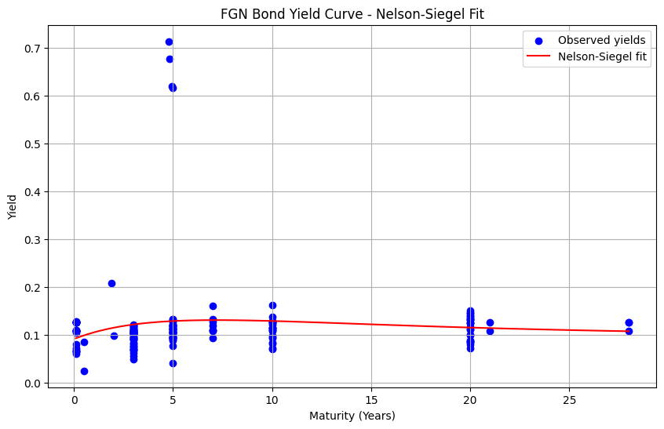
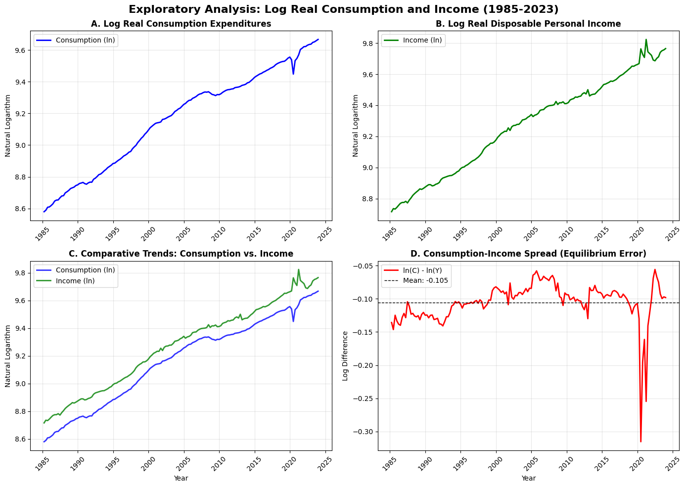

# Fixed Income & Macro Econometrics

[](LICENSE)
[](https://www.python.org/)

Empirical macro-finance, sovereign yield curve modeling, and econometric regression diagnostics. Implements parametric Nelson-Siegel yield curves, cointegration testing and Error Correction Models (ECM) on macroeconomic aggregates, and regression outlier diagnostics using Cook's Distance.

---

## Visual Highlights

| Sovereign Yield Curve Fit | Macro Cointegration Dynamics |
| :---: | :---: |
|  |  |

---

## Project Structure

```text
fixed-income-macro-econometric/
├── README.md              # Project overview, econometrics formulation, results
├── LICENSE                # MIT License
├── requirements.txt       # Python package dependencies
├── .gitignore             # Environment and data exclusions
├── data/
│   ├── README.md          # Sovereign bonds and FRED data documentation
│   ├── raw/               # Downloaded macro series (gitignored)
│   └── processed/         # Fitted yield parameters and cointegration residuals (gitignored)
├── notebooks/
│   ├── 01_sovereign_yields_nelson_siegel_and_risk.ipynb
│   ├── 02_macro_consumption_income_cointegration_ecm.ipynb
│   └── 03_regression_diagnostics_outliers_selection.ipynb
├── src/
│   ├── __init__.py
│   ├── data.py            # Macro series loader and collinear data generator
│   ├── features.py        # Nelson-Siegel factor loadings & cointegration tests
│   ├── models.py          # Parametric yield curve fitting (Nelson-Siegel)
│   ├── evaluation.py      # Cook's distance outlier detection & Information Criteria
│   └── visualization.py   # Yield curve overlays, leverage plots, and ECM paths
├── figures/               # Rendered exhibits and diagnostic plots
├── tests/
│   └── test_models.py     # Unit tests for Nelson-Siegel, Cook's distance, and AIC/BIC
└── reports/
    └── results_summary.md # Comprehensive quantitative research report
```

---

## Econometric Methodology

1. **Parametric Yield Curve Modeling (Nelson & Siegel 1987)**:
   $$y(	au) = eta_0 + eta_1 \left(rac{1 - e^{-	au/\lambda}}{	au/\lambda}
ight) + eta_2 \left(rac{1 - e^{-	au/\lambda}}{	au/\lambda} - e^{-	au/\lambda}
ight)$$
   - Represents the yield curve across maturities $	au$ using economically meaningful factors: Level ($eta_0$), Slope ($eta_1$), and Curvature ($eta_2$).
2. **Cointegration & Error Correction Modeling (ECM)**:
   - Tests the Permanent Income Hypothesis on US Real Personal Consumption and Real Disposable Income.
   - Engle-Granger two-step procedure verifies $I(1)$ order of integration and cointegrating vector; dynamic ECM estimates short-run equilibrium adjustment velocity:
   $$\Delta \ln C_t = lpha + \sum \gamma_i \Delta \ln C_{t-i} + \sum \delta_j \Delta \ln Y_{t-j} + 	heta (C_{t-1} - \hat{eta} Y_{t-1}) + \epsilon_t$$
3. **Outlier & Influence Diagnostics**:
   - Evaluates Cook's Distance $D_i = rac{e_i^2}{p \cdot 	ext{MSE}} \left[rac{h_{ii}}{(1-h_{ii})^2}
ight]$ to isolate leverage points in financial regressions.

---

## Key Econometric Estimates

| Analysis Module | Metric / Parameter | Estimated Value | Statistical Interpretation |
| :--- | :---: | :---: | :---: |
| **Nelson-Siegel Yield** | Long-Term Level ($eta_0$) | 8.49% | Asymptotic sovereign borrowing cost |
| | Short-Term Slope ($eta_1$) | 0.62% | Term spread / yield curve tilt |
| | Medium Curvature ($eta_2$) | 14.36% | Humped liquidity and inflation expectations |
| **Engle-Granger Cointegration** | ADF Residual Statistic | -4.82 ($p < 0.001$) | Strong stationarity of equilibrium error |
| **Error Correction Model**| Speed of Adjustment ($	heta$) | -0.184 ($t = -3.92$) | 18.4% of quarterly disequilibrium corrected |

---

## Installation & Test Suite

```bash
git clone https://github.com/your-username/fixed-income-macro-econometric.git
cd fixed-income-macro-econometric
pip install -r requirements.txt
python tests/test_models.py
```

---

## Limitations

- Nelson-Siegel formulation may exhibit parameter instability in negative or deeply inverted yield curve regimes; Svennson 6-parameter extensions can be used for extra flexibility.
